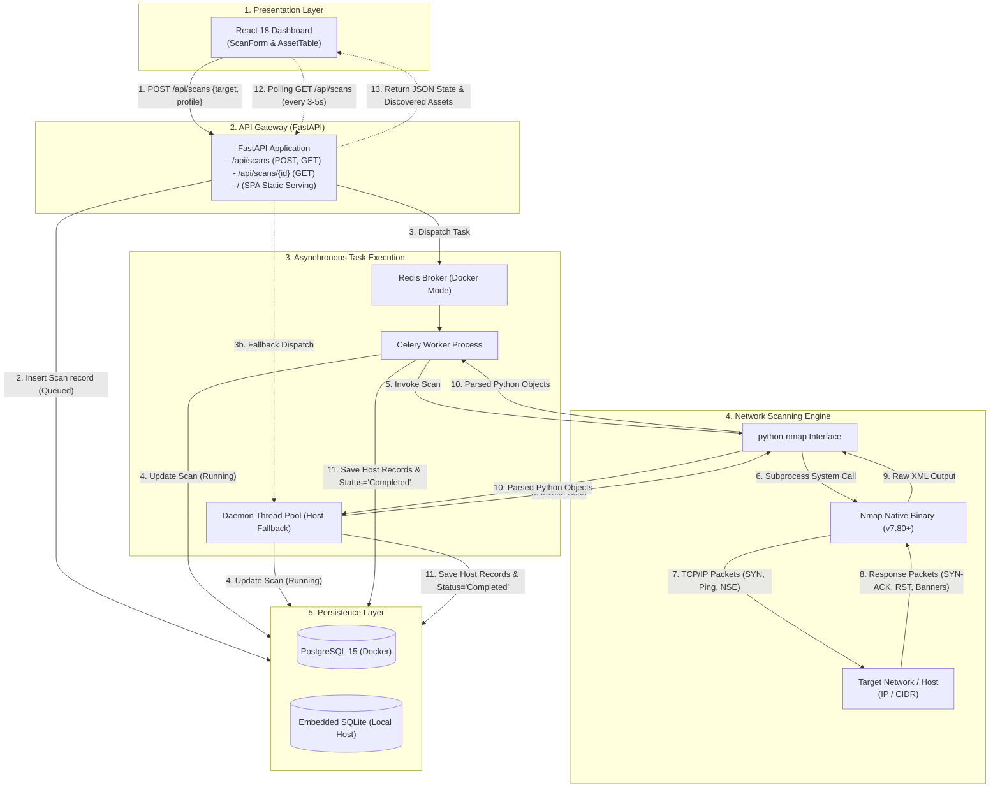
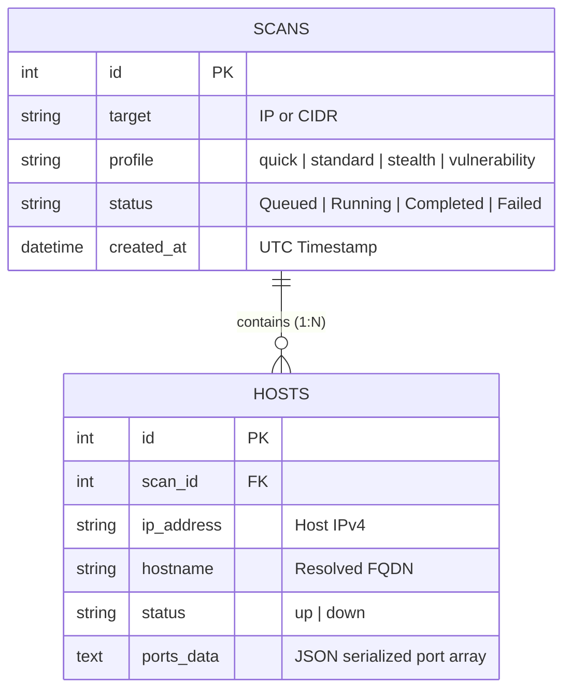

# NetLens: Nmap-Based Network Security Assessment & Infrastructure Discovery Framework

**Course Project**: Computer Networks & Ethical Hacking (CN&EH)  
**Repository**: [https://github.com/peddapulispoorthi-dev/CN-EH-CBP](https://github.com/peddapulispoorthi-dev/CN-EH-CBP)  
**Author**: Peddapuli Spoorthi  
**Version**: 1.0.0 (Production Release)

---

## Table of Contents
1. [Executive Summary](#1-executive-summary)
2. [Problem Statement & Objectives](#2-problem-statement--objectives)
3. [System Architecture & Data Flow](#3-system-architecture--data-flow)
4. [Technology Stack & Justification](#4-technology-stack--justification)
5. [Scan Profiles & Ethical Hacking Theory](#5-scan-profiles--ethical-hacking-theory)
6. [Database Schema & Data Models](#6-database-schema--data-models)
7. [API Contract & Specifications](#7-api-contract--specifications)
8. [Technical Constraints, Edge Cases & Solutions](#8-technical-constraints-edge-cases--solutions)
9. [Deployment & Operations Guide](#9-deployment--operations-guide)
10. [Test Results & Verified Outputs](#10-test-results--verified-outputs)
11. [Ethical, Legal & Compliance Considerations](#11-ethical-legal--compliance-considerations)
12. [Future Roadmap](#12-future-roadmap)

---

## 1. Executive Summary

**NetLens** is a full-stack, distributed network security assessment and infrastructure discovery framework. It automates network inventory discovery, port scanning, service banner grabbing, and vulnerability auditing by abstracting the low-level capabilities of **Nmap (Network Mapper)** into a responsive web platform.

Modern IT infrastructures consist of hundreds of heterogeneous devices—cloud instances, local workstations, IoT gadgets, and network gateways. NetLens addresses the complexity of manual CLI-based scanning by providing asynchronous task dispatching, relational discovery tracking, and a real-time reactive dashboard.

---

## 2. Problem Statement & Objectives

### 2.1 The Problem
- **CLI Inefficiency**: Running raw Nmap commands in terminals does not scale for continuous monitoring, historical analysis, or non-CLI team members.
- **Blocking Execution**: Comprehensive network audits (such as version detection `-sV` and vulnerability scanning `--script vuln`) take minutes to complete, blocking standard synchronous HTTP request/response loops.
- **Data Fragmentation**: Raw terminal or XML scan outputs are difficult to aggregate, compare across time, or correlate with previous assessments.
- **Privilege & Platform Discrepancies**: Raw socket packet crafting (SYN scans) requires root/administrative capabilities that behave differently across Windows and Linux environments.

### 2.2 Objectives
1. **Asynchronous Decoupled Scanning**: Decouple scan dispatch from execution using worker queues and background daemon threads so HTTP API calls return instantaneously.
2. **Automated Infrastructure Mapping**: Support both single-target inspection (`127.0.0.1`, `45.33.32.156`) and CIDR subnet sweeps (`192.168.1.0/24`).
3. **Structured Relational Storage**: Convert raw protocol scanner outputs into relational models for hosts, ports, states, and detected versions.
4. **Resilient Dual-Mode Runtime**: Ensure zero-configuration fallback so the platform runs seamlessly on single-node Windows environments without Docker, while maintaining enterprise Docker Compose multi-container support.

---

## 3. System Architecture & Data Flow

NetLens employs a decoupled, multi-tiered micro-architecture consisting of the Presentation Layer, API Gateway, Task Worker Queue, Scanning Engine, and Persistence Layer.

### 3.1 Architectural Diagram



### 3.2 End-to-End Execution Lifecycle
1. **Initiation**: The security analyst enters a target IP/CIDR and selects a profile in the React interface.
2. **Ingestion**: The API receives the payload, creates a row in `scans` with status `Queued`, and responds to the browser with HTTP 200 in `< 15ms`.
3. **Execution**: The background executor (Celery worker or daemon thread) changes the status to `Running` and executes the configured Nmap binary parameters.
4. **Parsing**: Nmap's raw protocol tree is parsed into structured dictionaries (Host IP, hostname, protocol, port number, port state, service name, banner version).
5. **Persistence**: Structured results are saved into `hosts` associated with `scan_id`. Scan status updates to `Completed`.
6. **Visualization**: The dashboard's periodic poller detects the status transition, loads the host data, and renders the interactive port table.

---

## 4. Technology Stack & Justification

| Layer | Technology | Version | Architectural Justification |
| :--- | :--- | :--- | :--- |
| **Frontend Framework** | **React.js** | 18.2.0 | Component-based state-driven UI; optimal for handling periodic polling and reactive updates. |
| **Frontend Tooling** | **Vite** | 5.4.x | Fast HMR (Hot Module Replacement) and optimized tree-shaken production bundling (`dist/`). |
| **Styling** | **Tailwind CSS** | 3.4.1 | Utility-first responsive design; dark-mode cyber-security aesthetic with slate/cyan color tokens. |
| **Icons** | **Lucide React** | 0.344.0 | Lightweight SVG icons representing security shields, activities, and servers. |
| **Backend Framework** | **FastAPI** | >=0.110.0 | High performance ASGI web framework; built-in asynchronous support, Pydantic validation, and automated OpenAPI Swagger docs. |
| **ASGI Server** | **Uvicorn** | >=0.28.0 | Lightning-fast ASGI production server capable of serving both API routes and static SPA bundles. |
| **ORM** | **SQLAlchemy** | >=2.0.28 | Enterprise-grade Object Relational Mapper supporting both PostgreSQL and SQLite transparently. |
| **Schema Validation** | **Pydantic** | >=2.6.4 | Strict data validation and serialization preventing recursive circular-reference errors. |
| **Task Queue** | **Celery** | >=5.3.6 | Industry standard distributed task queue for asynchronous and background execution. |
| **Message Broker** | **Redis** | >=5.0.2 | In-memory key-value store functioning as the task broker and result backend. |
| **Network Engine** | **Nmap + python-nmap** | 7.80+ / 0.7.1 | Core network auditing binary providing raw socket packet crafting, service detection, and NSE scripts. |
| **Containerization** | **Docker & Compose** | 3.8 Spec | Isolated multi-container deployment guaranteeing identical runtime environments with Linux capabilities (`NET_ADMIN`, `NET_RAW`). |

---

## 5. Scan Profiles & Ethical Hacking Theory

NetLens pre-configures four specialized scan profiles, each serving a distinct phase of the Ethical Hacking & Penetration Testing methodology:

```
+---------------------------------------------------------------------------------------+
|                               NETLENS SCAN PROFILES                                   |
+-------------------+-----------------------+-------------------+-----------------------+
| Profile Name      | Nmap Arguments        | Technique         | Methodology Phase     |
+-------------------+-----------------------+-------------------+-----------------------+
| Quick             | -sn                   | ICMP / TCP Pings  | Recon / Host Discovery|
| Standard          | -sV -p 1-1000         | TCP 3-Way Handshake| Service Enumeration   |
| Stealth           | -sS -T4               | Half-Open SYN Scan| Firewall Evasion      |
| Vulnerability     | -sV -O --script vuln  | NSE Scripting & OS| Vulnerability Audit   |
+-------------------+-----------------------+-------------------+-----------------------+
```

### 5.1 Quick Ping Discovery (`-sn`)
- **Networking Mechanism**: Disables port scanning completely (`No port scan`). In local subnets, Nmap issues ARP requests; over routable networks, it sends ICMP Echo Requests (`Type 8`), TCP SYN to port 443, TCP ACK to port 80, and ICMP Timestamp Requests (`Type 13`).
- **Ethical Hacking Use Case**: Fast network mapping. Allows analysts to quickly discover online nodes in a `/24` subnet without triggering port scan alerts in Intrusion Detection Systems (IDS).

### 5.2 Standard Service Scan (`-sV -p 1-1000`)
- **Networking Mechanism**: Connects to the top 1,000 most common ports using full TCP 3-way handshakes (`SYN` $\rightarrow$ `SYN-ACK` $\rightarrow$ `ACK`). Once connected, Nmap sends application-specific probe strings and listens for protocol banners.
- **Ethical Hacking Use Case**: Fingerprinting. Determines exact application versions (e.g. `Apache 2.4.41`, `OpenSSH 8.2p1`, `Microsoft-DS`) to match against known CVEs.

### 5.3 Stealth SYN Scan (`-sS -T4`)
- **Networking Mechanism**: Half-open scanning. Nmap sends a raw `SYN` packet. If the target responds with `SYN-ACK` (port open), Nmap immediately responds with a `RST` (reset) packet, terminating the connection before completion.
- **Ethical Hacking Use Case**: Evasion. Because the 3-way handshake is never completed, traditional application-layer logging does not record the connection attempt.

### 5.4 Deep Vulnerability Audit (`-sV -O --script vuln`)
- **Networking Mechanism**: Combines TCP/IP stack fingerprinting (analyzing TCP window sizes, sequence number predictability, and options) with the **Nmap Scripting Engine (NSE)** vulnerability category scripts.
- **Ethical Hacking Use Case**: Automated vulnerability identification. Probes for known remote code execution bugs, SSL heartbleed, default credentials, and unpatched exploits.

---

## 6. Database Schema & Data Models

The persistence layer is structured using SQLAlchemy ORM with a 1-to-many relationship between Scans and Discovered Hosts.



### 6.1 `ports_data` JSON Structure
The `ports_data` column stores structured protocol information:
```json
[
  {
    "port": 80,
    "protocol": "tcp",
    "state": "open",
    "service": "http",
    "version": "Apache httpd 2.4.41 ((Ubuntu))"
  },
  {
    "port": 22,
    "protocol": "tcp",
    "state": "open",
    "service": "ssh",
    "version": "OpenSSH 8.2p1 Ubuntu 4ubuntu0.5"
  }
]
```

---

## 7. API Contract & Specifications

FastAPI auto-generates interactive Swagger documentation accessible at **`/docs`** and ReDoc at **`/redoc`**.

### 7.1 `POST /api/scans` — Launch a Network Scan
- **Request Body**:
  ```json
  {
    "target": "192.168.29.1",
    "profile": "standard"
  }
  ```
- **Response** (`200 OK`):
  ```json
  {
    "scan_id": 4,
    "status": "Queued",
    "dispatched": true
  }
  ```

### 7.2 `GET /api/scans` — Retrieve Scan History
- **Response** (`200 OK`):
  ```json
  [
    {
      "id": 4,
      "target": "127.0.0.1",
      "profile": "standard",
      "status": "Completed",
      "created_at": "2026-10-23T18:46:54.426361"
    }
  ]
  ```

### 7.3 `GET /api/scans/{scan_id}` — Retrieve Discovered Assets & Ports
- **Response** (`200 OK`):
  ```json
  {
    "id": 4,
    "target": "127.0.0.1",
    "profile": "standard",
    "status": "Completed",
    "created_at": "2026-10-23T18:46:54.426361",
    "hosts": [
      {
        "id": 1,
        "scan_id": 4,
        "ip_address": "127.0.0.1",
        "hostname": "localhost",
        "status": "up",
        "ports_data": "[{\"port\": 135, \"protocol\": \"tcp\", \"state\": \"open\", \"service\": \"msrpc\", \"version\": \"\"}]"
      }
    ]
  }
  ```

### 7.4 `GET /api/health` — Health Check
- **Response** (`200 OK`):
  ```json
  {
    "status": "healthy",
    "service": "NetLens API"
  }
  ```

---

## 8. Technical Constraints, Edge Cases & Solutions

### 8.1 Python 3.13 Wheel Incompatibility
- **Constraint**: `psycopg2-binary==2.9.9` lacked pre-built binary wheels for Python 3.13 on Windows, forcing `pip` to compile C source code and failing with `Error: pg_config executable not found`.
- **Solution**: Upgraded dependencies to `psycopg2-binary>=2.9.10` and flexible bounds (`>=`), ensuring pre-compiled C-wheels install with zero compilation prerequisites.

### 8.2 Database Failover & Relative Path Working Directory Discrepancy
- **Constraint**: When running standalone on Windows without PostgreSQL, SQLite fell back to relative `./netlens.db`. When background worker threads executed from different working directories, SQLite looked for tables in empty databases, raising `OperationalError: no such table: scans`.
- **Solution**: Anchored SQLite to an absolute path (`os.path.join(os.path.dirname(__file__), "netlens.db")`) and added an automated `init_db()` routine that creates tables across all threads upon initialization.

### 8.3 FastAPI Circular Reference Serialization Error
- **Constraint**: In SQLAlchemy, `Scan.hosts` and `Host.scan` establish bidirectional relationships. Raw serialization causes `RecursionError: maximum recursion depth exceeded`.
- **Solution**: Implemented explicit Pydantic v2 schemas (`HostResponse`, `ScanDetailResponse`) configured with `from_attributes = True`, decoupling ORM relationships from JSON serialization.

### 8.4 Single-Port Unified Production Serving
- **Constraint**: Running development environments requires two terminal windows (`npm run dev` on `5173` and `uvicorn` on `8000`), introducing CORS overhead and confusing non-technical evaluators.
- **Solution**: Built Vite assets into `dist/` and mounted them inside FastAPI using `StaticFiles` and an explicit `@app.get("/")` handler. The entire platform (React UI + REST API) runs on a single unified port: `http://localhost:8000`.

### 8.5 Port Conflict & Smart Failover
- **Constraint**: If an orphaned process or external software occupies port 8000, subsequent server launches crash with `Address already in use`.
- **Solution**: Built smart port-detection into `start_netlens.bat` and `start_netlens.ps1` that checks port availability and dynamically increments to the next free port (`8001`, `8002`, etc.) while updating the browser launcher automatically.

---

## 9. Deployment & Operations Guide

### 9.1 Mode A: 1-Click Local Production Deployment (Recommended)
Ideal for class presentations, lab computers, and local evaluations without Docker.

1. Navigate to the project root:
   ```powershell
   cd "c:\Users\admin\OneDrive\Desktop\Projects\An Nmap-Based Network Security Assessment and Infrastructure Discovery Framework"
   ```
2. **Double-click `start_netlens.bat`** (or run `.\start_netlens.ps1` in PowerShell).
3. The launcher automatically:
   - Verifies Python and Nmap
   - Builds frontend production assets
   - Allocates an available port
   - Starts the unified server
   - Opens `http://localhost:8000` in your default browser

### 9.2 Mode B: Multi-Container Docker Compose Deployment
Ideal for cloud servers (AWS EC2, DigitalOcean, Linode) or production enterprise environments.

1. Ensure **Docker Desktop** / **Docker Engine** is running.
2. Open terminal in the `netlens` directory:
   ```bash
   cd netlens
   docker-compose up --build
   ```
3. Endpoints:
   - React Dashboard: `http://localhost:5173`
   - FastAPI Docs: `http://localhost:8000/docs`
   - PostgreSQL Database: `localhost:5432`
   - Redis Broker: `localhost:6379`

### 9.3 Mode C: Cloud Linux VPS Deployment
1. Provision an Ubuntu 22.04 LTS instance.
2. Install Docker & Git:
   ```bash
   sudo apt update && sudo apt install -y git curl
   curl -fsSL https://get.docker.com | sh
   ```
3. Clone and deploy:
   ```bash
   git clone https://github.com/peddapulispoorthi-dev/CN-EH-CBP.git
   cd CN-EH-CBP/netlens
   docker compose up -d --build
   ```

---

## 10. Test Results & Verified Outputs

The framework was verified against local loopback and authorized external hosts:

### Test 1: Local Loopback (`127.0.0.1`) — Standard Profile (`-sV`)
- **Status**: `Completed`
- **Discovered Host**: `127.0.0.1` (`localhost`)
- **Open Ports**:
  - `135/tcp` — `open` — `msrpc`
  - `137/tcp` — `filtered` — `netbios-ns`
  - `445/tcp` — `open` — `microsoft-ds`

### Test 2: Local Wi-Fi Gateway (`192.168.29.1`) — Standard Profile (`-sV`)
- **Status**: `Completed`
- **Discovered Host**: `192.168.29.1`
- **Open Ports**:
  - `53/tcp` — `open` — `domain` (Local DNS relay)
  - `80/tcp` — `open` — `http` (Router Admin Web Interface)
  - `443/tcp` — `open` — `https` (SSL Management)

### Test 3: Authorized Remote Host (`scanme.nmap.org`) — Standard Profile (`-sV`)
- **Status**: `Completed`
- **Discovered Host**: `45.33.32.156` (`scanme.nmap.org`)
- **Open Ports**:
  - `22/tcp` — `open` — `ssh` (OpenSSH 6.6.1p1)
  - `80/tcp` — `open` — `http` (Apache httpd 2.4.7)
  - `9929/tcp` — `open` — `nping-echo`

---

## 11. Ethical, Legal & Compliance Considerations

1. **Authorization**: In accordance with the Computer Fraud and Abuse Act (CFAA), Section 43/66 of the Indian Information Technology Act, and international cyber laws, port scanning and vulnerability probing must only be conducted against networks and hosts for which explicit, written authorization has been granted.
2. **Authorized Test Targets**: For learning and verification, use authorized test targets such as `scanme.nmap.org` or internal sandbox environments (`127.0.0.1`, local lab subnets).
3. **Denial of Service (DoS) Caution**: Intense timing flags (such as `-T5`) or aggressive vulnerability audit scripts (`--script vuln`) can crash fragile legacy embedded systems or IoT devices. Standard profiles in NetLens are rate-controlled with `-T4` and targeted port limits.

---

## 12. Future Roadmap

1. **Scheduled Automated Auditing**: Implement recurring cron-based scanning to detect unauthorized rogue devices connected to the enterprise perimeter.
2. **PDF / Executive Compliance Reports**: Add automated PDF export providing executive summaries, risk scores, and remediation guides based on detected CVEs.
3. **Webhook & Slack/Discord Alerts**: Trigger real-time notifications whenever high-risk ports (e.g., Telnet `23`, RDP `3389`, SMB `445`) are exposed to the public Internet.
4. **Network Topology Graphing**: Visualize discovered assets on an interactive node-link graph (e.g. using D3.js or Cytoscape) showing subnet clustering.
